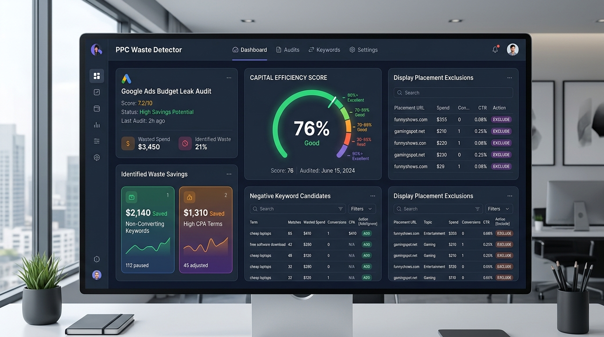

# PPC Waste Detector 🎯💸

[](https://github.com/hamid-digitalmarketer/ppc-waste-detector/actions/workflows/ci.yml)
[](https://www.python.org/downloads/)
[](https://opensource.org/licenses/MIT)
[](https://github.com/astral-sh/ruff)
[](http://mypy-lang.org/)
[](https://abouthamid.web.app/)
[](https://www.linkedin.com/in/muhammad-hamid-digital-marketing/)
[](mailto:mhamidlad@gmail.com)

> **A production-grade, open-source PPC budget leak detector for Google Ads and Meta Ads.**  
> Automatically detects search query bleed, internal keyword cannibalization, junk mobile app placements, geo-location bleed, off-hour dayparting spikes, and runaway smart bidding CPC anomalies. Generates one-click exclusion lists for **Google Ads Editor** and self-contained interactive Tailwind CSS audit dashboards.

---



---

## ⚡ The Problem: Invisible PPC Ad Spend Bleed

Modern paid search and display platforms optimize for inventory monetization, often hiding budget waste inside broad matching, Performance Max black boxes, and multi-network default settings:

1. **Broad Match Query Bleed**: Broad match expansion captures low-intent, non-converting queries (`free`, `login`, `jobs`, `tutorial`).
2. **Internal Keyword Cannibalization**: Multiple campaigns or ad groups bid against each other on the same search queries, driving up your own clearing CPCs.
3. **GDN / PMax Junk Placements**: Display campaigns and Performance Max silently serve impressions on hyper-casual mobile games (`mobileapp::*`) and MFA click-farms with high accidental click-through rates and 0% conversion rates.
4. **Geographic Bleed**: Ads show to users outside your targeted geographies due to Google's default *"Presence or interest"* setting.
5. **Dayparting Waste**: High budget burns between 1:00 AM and 5:00 AM with zero conversions and unstaffed sales teams.
6. **Smart Bidding Runaways**: Automated bidding algorithms aggressively bid on low-intent search terms during inventory spikes without CPC ceilings.

**PPC Waste Detector** parses your raw Google Ads or Meta Ads performance CSV reports and pinpoints every wasted dollar with mathematical rigor.

---

## 🚀 Key Features

- 🔍 **6 Specialized Detection Engines**:
  - `SearchQueryBleedDetector`: Flags negative-intent queries, zero-conversion high-spend queries, and traffic spikes.
  - `KeywordCannibalizationDetector`: Maps internal cross-campaign auction conflicts and calculates wasted delta spend.
  - `JunkPlacementLeakDetector`: Detects spam domains, MFA click-farms, and mobile game app IDs (`mobileapp::*`).
  - `GeoBleedDetector`: Catches impressions and spend occurring outside your target service areas.
  - `DaypartingWasteDetector`: Identifies off-peak hourly budget burns with conversion rates below 10% of account average.
  - `SmartBiddingRunawayDetector`: Detects severe CPC inflation ($>3\times$ median) triggered by unconstrained automated bidding.
- 📋 **Google Ads Editor Ready**:
  - `negative_keywords_editor.csv`: Formatted with `Campaign`, `Ad Group`, `Criterion Type`, `Keyword` for bulk import.
  - `placement_exclusions_editor.csv`: Formatted for instant PMax and GDN placement exclusions.
  - Plaintext fallback files (`.txt`) for copy-pasting directly into the Google Ads Web UI.
- 📊 **Executive & Engineering Reports**:
  - **Interactive Tailwind CSS Report**: Standalone HTML dashboard with zero external runtime dependencies.
  - **Flat CSV & Structured JSON**: Ready for data warehouses, BigQuery, or Slack alerting webhooks.
  - **SQLite Database Persistence**: Audit history stored locally in `reports/ppc_waste.sqlite`.
- 🛠️ **Local CLI & Web Server**: Run one-off audits in your terminal with rich colored tables, or serve the visual dashboard locally.
- 🔒 **100% Privacy & Zero API Cost**: Runs entirely on your local machine. No external API keys required. Your proprietary ad spend data never leaves your environment.

---

## 📦 Installation

```bash
# Clone the repository
git clone https://github.com/hamid-digitalmarketer/ppc-waste-detector.git
cd ppc-waste-detector

# Install package and dependencies
pip install -e ".[dev]"
```

---

## 🛠️ Quick Start

### 1. Run Audit with Built-in Sample Data
You can test the detection algorithms immediately using the included synthetic datasets representing a real-world multi-campaign account:

```bash
ppc-waste audit
```

To automatically launch the generated interactive HTML report in your default browser:
```bash
ppc-waste audit --open-browser
```

### 2. Audit Your Own Google Ads Exports
Export your standard performance CSV reports from Google Ads or Google Ads Editor and run:

```bash
ppc-waste audit \
  --search-queries path/to/Search_Query_Report.csv \
  --placements path/to/Placement_Report.csv \
  --geo-hourly path/to/Geo_Hourly_Report.csv \
  --out-dir ./audit_results \
  --cost-threshold 50.0 \
  --clicks-threshold 10
```

### 3. Launch Local Audit Web Viewer
```bash
ppc-waste serve --port 8000
```
Then navigate to `http://localhost:8000` to browse your latest findings.

---

## 💻 Programmatic Python Usage

Integrate `ppc-waste-detector` into your scheduled Python pipelines or data workflows:

```python
from pathlib import Path
from ppc_waste_detector.data.loader import load_search_queries, load_placements
from ppc_waste_detector.detectors import SearchQueryBleedDetector, JunkPlacementLeakDetector
from ppc_waste_detector.report import ReportGenerator

# Load reports
search_rows = load_search_queries(Path("data/sample_data/google_search_queries.csv"))
placement_rows = load_placements(Path("data/sample_data/display_placement_performance.csv"))

# Run detectors
findings = []
findings.extend(SearchQueryBleedDetector(cost_threshold=50.0, clicks_threshold=10).run(search_rows))
findings.extend(JunkPlacementLeakDetector().run(placement_rows))

# Generate export artifacts
reporter = ReportGenerator(output_dir=Path("./reports"))
paths = reporter.generate_all(findings)
print(f"Audit completed! HTML report saved at: {paths['html']}")
```

---

## 📁 Repository Structure

```
ppc-waste-detector/
├── .github/
│   ├── ISSUE_TEMPLATE/        # Bug report and feature request templates
│   ├── workflows/ci.yml       # GitHub Actions CI matrix (Python 3.11, 3.12)
│   └── pull_request_template.md
├── data/
│   ├── loader.py              # CSV ingestion and sanitization routines
│   └── sample_data/           # Synthetic real-world test datasets
│       ├── google_search_queries.csv
│       ├── display_placement_performance.csv
│       └── geo_hourly_performance.csv
├── docs/
│   ├── architecture.md        # Technical architecture and data models
│   ├── usage.md               # Complete CLI & API documentation
│   ├── waste_categories.md    # Leak taxonomy and algorithmic formulas
│   └── report_preview.png     # Dashboard screenshot
├── src/ppc_waste_detector/
│   ├── detectors/             # 6 Specialized leak detection modules
│   │   ├── search_query_bleed.py
│   │   ├── keyword_cannibalization.py
│   │   ├── junk_placement_leak.py
│   │   ├── geo_bleed.py
│   │   ├── dayparting_waste.py
│   │   └── smart_bidding_runaway.py
│   ├── exporters/             # Negative keyword & placement exclusion formatters
│   │   ├── negative_keywords.py
│   │   └── placement_exclusions.py
│   ├── templates/             # Jinja2 Tailwind CSS HTML report template
│   │   └── report.html
│   ├── cli.py                 # Typer command-line interface
│   ├── models.py              # Pydantic data schemas
│   ├── report.py              # HTML, CSV, JSON multi-format generator
│   └── storage.py             # SQLite persistence engine
├── tests/                     # 14 Comprehensive pytest unit and integration tests
│   ├── test_cli.py
│   ├── test_detectors.py
│   ├── test_exporters.py
│   └── test_report.py
├── CONTRIBUTING.md            # Guidelines for open source contributors
├── LICENSE                    # MIT License
└── pyproject.toml             # Modern PEP 621 packaging and dependencies
```

---

## 🧪 Testing & Quality Assurance

All pull requests and commits are verified against Python 3.11 and 3.12:

```bash
# Run unit and integration tests
pytest -v

# Run linter
ruff check .

# Run static type checker
mypy src
```

---

## 📄 License

This project is licensed under the [MIT License](LICENSE) - see the LICENSE file for details.

---

## 💼 Done-For-You PPC Audits & Enterprise Growth Consulting

> **Stop bleeding ad budget.** If your business spends **\$10,000 to \$500,000+/month** on Google Ads or Meta Ads, undetected broad-match leaks, bot placements, and cross-campaign cannibalization quietly drain **15% to 35%** of your ad investment.

As a **Digital Marketing Head with 7+ years of experience** leading performance marketing for healthcare networks, BPOs, and high-growth e-commerce brands across the US, UK, and international markets, I help brands and agencies reclaim wasted spend and scale profitably.

### 🎯 Engagement Options

| Service Tier | Best For | What's Included | Typical Impact |
|---|---|---|---|
| **🔍 Forensic PPC Waste Audit** | Brands spending \$10k–\$100k/mo | Full forensic review of search queries, cannibalization, PMax placements, dayparting, bidding anomalies + prioritized 30-day remediation roadmap | Reclaims **\$2,500–\$15,000/mo** in wasted ad spend within 14 days |
| **⚙️ Custom Enterprise Automation** | Agencies & multi-account brands | Automated negative keyword sync pipelines, custom Python connectors to BigQuery/Snowflake, automated Slack alert bots | Zero manual query scrubbing; real-time leak prevention across 50+ accounts |
| **👑 Fractional Head of Paid Media / CMO** | Scale-ups & growing enterprises | Full-funnel paid acquisition strategy across Google, Meta & TikTok Ads, team leadership, budget allocation & ROAS scaling | Reduced customer acquisition cost (CAC) by up to **70%**, predictable revenue growth |

---

### 🚀 Ready to Stop Ad Waste?

Let's review your account and build an automated leak-prevention system:

- 🌐 **Portfolio & Case Studies**: [abouthamid.web.app](https://abouthamid.web.app/)
- 💼 **LinkedIn Profile**: [linkedin.com/in/muhammad-hamid-digital-marketing](https://www.linkedin.com/in/muhammad-hamid-digital-marketing/)
- 📩 **Direct Business Email**: [`mhamidlad@gmail.com`](mailto:mhamidlad@gmail.com)
- 📅 **Book a 1-on-1 Strategy Session**: [Schedule Discovery Call](https://abouthamid.web.app/)

<p align="center">
  <a href="https://abouthamid.web.app/"></a>
  <a href="https://www.linkedin.com/in/muhammad-hamid-digital-marketing/"></a>
  <a href="mailto:mhamidlad@gmail.com"></a>
</p>

---

## 👤 Author & Open Source Community

Created and maintained by **Muhammad Hamid** ([@hamid-digitalmarketer](https://github.com/hamid-digitalmarketer)).  
Found a bug or have an idea for a new leak detector? Open an [issue](https://github.com/hamid-digitalmarketer/ppc-waste-detector/issues) or submit a pull request!

